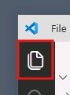
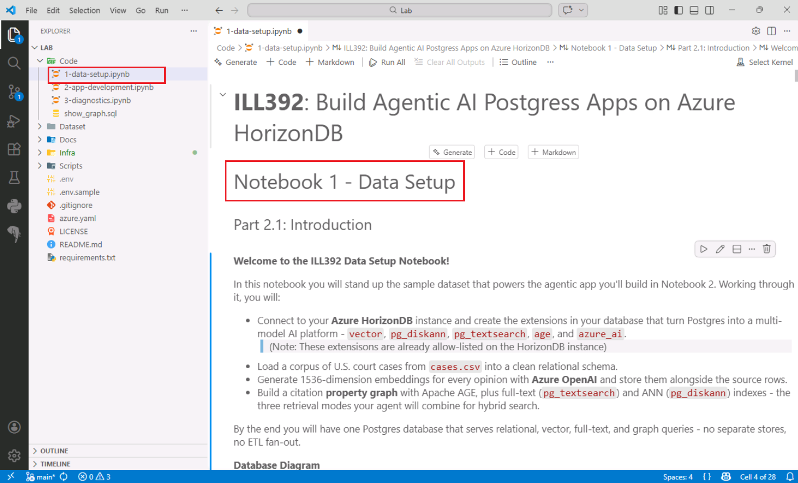

# Part 2 - Prepare the data for your AI assistant

## 2.1 Prepare the case data

Notebook 1 builds the HorizonDB knowledge layer for the Compliance Advisor Agent. You will load Washington State court cases and prepare BM25 full-text search, vector search, and graph queries.

These capabilities support two business questions from the Caldova scenario: have we encountered something similar, and what evidence supports the conclusion? Relational rows hold the case facts, vectors find similar issues, and the citation graph connects related decisions.

1. In VS Code, select **Explorer** on the left.

    

2. Expand the `Code` folder and open `1-data-setup.ipynb`.

    

3. Keep this instruction page open alongside the notebook.

### Run the cells

Start at the top of the notebook. Select the **Run Cell** play button beside each code cell, one at a time, and wait for it to finish. Skip any text-only cells.

Follow the sections below in order; each run step moves to the next code cell. If a cell reports an error, stop and ask your facilitator for help.

## 2.2 Load the Python libraries

`psycopg` connects Python to PostgreSQL. The Azure OpenAI client generates embeddings, and `dotenv` loads the prepared configuration without putting credentials in the code.

1. Run **the first code cell**.
2. When VS Code asks for an environment, select **Python Environments** > **Python 3.13.9**, not **Python 3.14.7**. If a different kernel is already selected, click its name at the top right to change it.
3. Wait for the cell to finish without an error. No printed output is expected.

    The packages are already installed. If you see `ModuleNotFoundError`, check that you selected Python 3.13.9.

## 2.3 Read the connection settings

The notebook reads the prepared `.env` file. It contains the HorizonDB connection settings and two Azure OpenAI deployments: a chat model for generation and extraction, and an embedding model for vector search.

1. Run **the next code cell**.
2. Check that three values print: the chat deployment name, embedding deployment name, and API version.

    If you see `KeyError`, a required setting is missing. Ask your facilitator for help and keep keys and passwords out of shared error messages.

## 2.4 Enable the HorizonDB extensions

PostgreSQL extensions provide the advisor's retrieval and AI capabilities. `vector` and `pg_diskann` support vector search, `pg_textsearch` provides BM25 full-text search, `age` provides Apache AGE graph queries, and `azure_ai` provides AI functions callable from SQL.

1. Run **the next code cell**.
2. Check for five extension-ready messages followed by `Done. Extensions Created.`

    If an extension fails to load, ask your facilitator for help. The [optional diagnostics exercise](optional-diagnostics.md) checks a server setting used by keyword search.

## 2.5 Register the AI models

The `azure_ai` model registry connects SQL functions to the prepared Azure OpenAI deployments. Each model has an alias: `lab-chat` for the chat model and `lab-embedding` for the embedding model. The registry stores the endpoint and authentication details.

1. Run **the next code cell**.
2. Check that `lab-chat` and `lab-embedding` are registered and appear in the verification rows.

    The assistant will use `lab-chat` later to extract facts from case opinions.

## 2.6 Load the court cases

The dataset is at `C:\Lab\Dataset\cases.csv`. This step loads it into PostgreSQL relational tables.

The notebook uses `COPY` to load raw JSON records into `temp_cases`, then extracts case names, dates, courts, and opinion text into `cases`. It keeps the raw citations for the graph-building step.

> [!WARNING]
> This step deletes and recreates the `cases` and `temp_cases` tables. Use only the database created for this lab.

1. Run **the next code cell**.
2. Check that `CSV path:` points to the dataset above.
3. Wait for `Done. <N> cases loaded into the cases table.` The count must be greater than zero. Note the count for the graph check later.

    Allow around 30 to 60 seconds. If the cell cannot find the file, ask your facilitator to check the printed path.

## 2.7 Check the loaded cases

The relational data supplies the case IDs and facts that the agent's tools will return. The same IDs connect the search results to graph nodes and extracted facts.

1. Run **the next code cell**.
2. Check that five case rows print. Find a case name, date, court, and opinion text.

    The diagram shows the relational data model.

    

## 2.8 Add the vector column

An embedding represents text as a vector so that related text can be compared numerically. This is how the advisor can find a similar issue when the wording differs. The prepared model returns 1,536 values per embedding, so this step adds an `opinions_vector` column of type `vector(1536)`.

1. Run **the next code cell**.
2. Check for `opinions_vector column added.`

## 2.9 Generate the opinion embeddings

Azure OpenAI generates embeddings from the case text, and the notebook stores them in HorizonDB. These vectors will let the advisor find similar situations even when the question and opinion use different words.

1. Run **the next code cell**.
2. Watch the progress messages. Wait for 100% and `Done. <N> rows processed.`

    Allow several minutes.

    For this lab, each embedding uses the case name and up to the first 8,000 characters of the opinion. Later passages in longer opinions are not represented.

    > [!NOTE]
    > Rerunning this cell clears existing embeddings and starts again. If it is interrupted, ask your facilitator for help before retrying.

## 2.10 Build the citation graph with Apache AGE

Apache AGE stores a property graph in the same PostgreSQL database. Each node represents a case, and each directed `REF` edge records that one case cites another. Graph queries will expand the agent's search from similar cases to related precedents.

This step rebuilds `case_graph`. Citations to cases outside the sample are not included.

1. Run **the next code cell**.
2. Compare `Node count:` with the case count you noted during data loading. They should match.
3. Wait for `Done. Case graph is ready.` Creating the links can take several minutes.

    

## 2.11 Build and test the BM25 full-text index

BM25 ranks case opinions against query terms. It helps answer "Is there precedent?" when the relevant legal term or doctrine is known. Vector search will handle similar fact patterns expressed in different words. The index covers opinion text, not case names.

1. Run **the next code cell**.
2. Check for `pg_textsearch extension is ready.` and five case matches for `water leaking` under `Top matches`. If no matches print, stop and ask your facilitator for help.

    The BM25 score ranks keyword matches. Lower, more negative scores are stronger matches for this query, not confidence percentages.

    This BM25 search does not support phrase or fuzzy queries.

## 2.12 Build the DiskANN vector index

DiskANN is an approximate nearest neighbor index for vector search. It lets the advisor find similar issues without comparing the question with every stored vector. This lab uses cosine distance to compare the opinion embeddings.

1. Run **the next code cell**.
2. Wait for `pg_diskann ready: idx_cases_diskann`. This can take a couple of minutes.

## 2.13 Visualize the relational schema and citation graph

Use the VS Code PostgreSQL extension to inspect the database you just built. The schema visualizer shows tables and column types; the graph visualizer shows case nodes and citation edges. There is no additional notebook cell.

### View the tables

1. Select the **PostgreSQL** elephant icon on the left.
2. Expand the `lab` connection.
3. Right-click the `postgres` database and select **Visualize Schema**.
4. Use the eye icon to hide schemas other than `public`.

    

5. Find `cases` and check that it has an `opinions_vector` column.

    

### View the citation graph

1. Right-click `postgres` and select **New Query**.
2. Copy the query below into the editor. It is also in `C:\Lab\Code\show_graph.sql`.

    ```sql
    SET search_path = public, ag_catalog, "$user";

    SELECT * FROM cypher('case_graph', $$
        MATCH (n)-[r]->(m)
        RETURN n, r, m
    $$) AS (source agtype, edge agtype, target agtype);
    ```

3. Select the query editor's **Run** play button.
4. Open the graph view in the results. Find two case nodes joined by a `REF` edge: the source case cites the target case.

    

The HorizonDB knowledge layer is ready. Continue to [Part 3 - Build and try the AI assistant](part-3-agentic-app-development.md) to expose these capabilities as agent tools.
