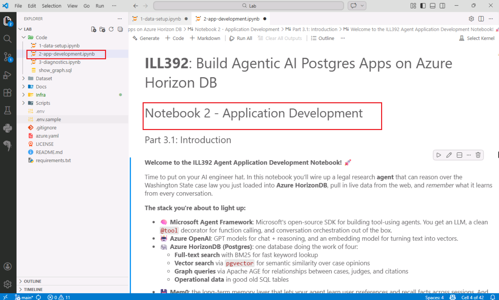

# Part 3 - Build and try the AI assistant

## 3.1 Build a Compliance Advisor Agent

Notebook 1 gave the Compliance Advisor Agent its knowledge. Notebook 2 gives it tools to retrieve and use that knowledge.

Cassandra needs evidence she can inspect before making a recommendation. Microsoft Agent Framework lets the Azure OpenAI model call tools, inspect their results, and use the evidence in its response. You will first test the tools directly, then let the agent coordinate them.

The prepared questions use the Seattle property-flooding dispute as a stand-in for a compliance review. Keep that worked example throughout the exercises so you can see how the agent moves from a business question to precedent, supporting evidence, and a reviewable answer.


> [!IMPORTANT]
> This is a learning example, not legal advice. The sample dataset and shortened opinion text can produce incomplete answers. Review generated claims against their sources.

### Open Notebook 2

Complete [Part 2](part-2-data-setup.md) first.

1. In VS Code Explorer, expand the `Code` folder in `C:\Lab`.
2. Open `2-app-development.ipynb` and keep this page alongside it.

    

### Run the cells

Start at the top of the notebook. Use **Run Cell** to run one code cell at a time and wait for it to finish. Skip any text-only cells.

Follow the sections below in order; each run step moves to the next code cell. If a cell reports an error, check its output and the preceding step, then ask your facilitator for help. If an expected tool call is missing, retry that agent cell once before asking for help.

## 3.1.1 Load the application libraries

The installed libraries provide Microsoft Agent Framework, Azure OpenAI access, PostgreSQL connections, Mem0 memory, and the Gradio chat interface.

1. Run **the first code cell**.
2. When asked for an environment, select **Python Environments** > **Python 3.13.9**, not **Python 3.14.7**. To change an existing selection, click the kernel name at the top right.
3. Wait for the cell to finish without an error. No printed output is expected.

## 3.1.2 Read the connection settings

This notebook reads the prepared `.env` settings again for its new Python session.

1. Run **the next code cell**.
2. Check that the chat deployment name, embedding deployment name, and API version print.

## 3.2 Define the BM25 search tool

When Cassandra knows a legal term and asks whether there is precedent, BM25 full-text search retrieves opinions containing those terms. In this exercise, the example term is "drainage."

Microsoft Agent Framework uses the `@tool` decorator to make a Python function available to the agent. The tool and parameter descriptions tell the model when to use it and what information to supply.

1. Run **the next code cell** to define `keyword_case_search`.
2. Check that it finishes without an error. No printed output is expected yet.

## 3.2.1 Test BM25 search directly

This cell calls the Python function directly. It verifies the database query before asking the agent to choose search terms.

1. Run **the next code cell**.
2. Look for `keyword_case_search was called` and up to five case rows. Pick one result and identify its case ID, name, court, and opinion snippet.

    Lower, more negative BM25 scores indicate stronger keyword matches within this query.

    Each result contains a short opinion snippet, not the full judgment.

## 3.2.2 Give the agent its first tool

The sample question describes a Seattle property flooding after road drainage changes. Instead of receiving search terms directly, the agent must choose terms from that question, call BM25 search, and use the returned cases in its answer.

This cell creates an agent with keyword search. Later agent cells create it again with the additional tools you have defined.

1. Run **the next code cell**.
2. Look for `keyword_case_search was called` under `// Functions the Agent Called: //`.
3. Read `// Agent Response: //`. Find a cited case in the tool results and check what evidence it adds to the answer.

    The trace confirms tool use, not that the answer is correct.

## 3.3 Define the vector search tool

When an issue is described in business language rather than legal terminology, vector search finds similar fact patterns even when the wording differs. It complements BM25's keyword matching.

Azure OpenAI embeds the question, and HorizonDB compares it with the stored opinion vectors. DiskANN advanced filtering applies court and year predicates during retrieval, avoiding a separate post-filter that could discard most matches.

1. Run **the next code cell** to define `semantic_case_search`.
2. Check that it finishes without an error. No printed output is expected yet.

## 3.3.1 Compare BM25 and vector search

1. Run **the next code cell**.
2. Compare `Tool 1 ids` and `Tool 2 ids`. Find any cases returned by only one method.

    The calls intentionally use different inputs. BM25 searches legal terms within Washington Supreme Court cases. Vector search uses a natural-language fact pattern across both courts. Differences can come from the retrieval method, query wording, or court scope.

3. Check `Union  ids`, the combined candidate list.

    Combining both result sets is hybrid search. Duplicate IDs appear only once. In the vector-search trace, `advanced_filtering=ALWAYS_ON` confirms that the tool enabled DiskANN advanced filtering. The broad sample uses both courts and a starting year of 1900, so those filters narrow little. Vector results show `distance`, where lower values indicate closer matches.

## 3.3.2 Add hybrid search to the agent

The agent now has two ways to answer the same business question. It can use BM25 when the terminology is known and vector search when the issue is described by its meaning.

1. Run **the next code cell**.
2. Check that the trace includes both `keyword_case_search` and `semantic_case_search`.
3. Compare this with the BM25-only agent's answer. Look for evidence added by vector search, or note if the same cases are used.

## 3.4 Define the Apache AGE graph tool

To understand what supports a conclusion, Cassandra needs relationships as well as similar documents. The graph tool takes the hybrid-search case IDs and follows up to two Apache AGE `REF` edges in either direction to retrieve related precedents.

1. Run **the next code cell** to define `precedent_graph_search`.
2. Check that it finishes without an error. No printed output is expected yet.

## 3.4.1 Test hybrid search with graph expansion

1. Run **the next code cell**.
2. Find `Input ids:`, the cases from BM25 and vector search.
3. Find `RELATED_CASE_IDS:`, the additional cases found through citations. The graph returns up to ten.

    Pick a related case that is not in the input list. Graph retrieval adds connected precedents, not another list of semantic matches. Washington Supreme Court decisions receive extra ranking weight.

## 3.4.2 Add graph retrieval to the agent

The agent must now chain its tools: combine the BM25 and vector case IDs, then pass those IDs to the graph tool to retrieve related precedents.

1. Run **the next code cell**.
2. Check that the trace includes `keyword_case_search`, `semantic_case_search`, and `precedent_graph_search`.
3. Find a related case in the answer and compare it with the results from the direct graph test.

## 3.5 Define the in-database AI extraction tool

Retrieved documents are useful only if Cassandra can inspect the facts behind the recommendation. This tool calls `azure_ai.extract` from SQL to extract the court's ruling, issues, cited laws, and case outcome from the graph results.

It uses `lab-chat`, the model alias registered during data setup, and returns named fields that the agent can reuse in its draft.

1. Run **the next code cell** to define `case_analyst_extract`.
2. Check that it finishes without an error. No printed output is expected yet.

    The lab sends only the first 1,200 characters of each opinion to the model. Important facts may be missing from that excerpt. The text is sent to Azure OpenAI even though the request starts in SQL.

## 3.5.1 Add extracted facts to the answer

This run extends the chain again. After finding and expanding the cases, the agent asks HorizonDB to extract facts that Cassandra can inspect in the final answer.

1. Run **the next code cell**.
2. Check that the trace includes the three search tools and `case_analyst_extract was called`.
3. Compare this with the answer before extraction was added. Identify a ruling, issue, statute, or outcome used to support the analysis, rather than a case name alone.

    If a result contains `extraction_failed`, that case's analysis failed. An `extracted_case=` completion line alone does not prove success. Ask your facilitator for help before relying on the answer.

## 3.6 Define the external weather tool

The flooding claim also needs evidence about the event itself. The Open-Meteo tool adds historical precipitation records from an external API to the database research. The agent uses it only when weather is relevant.

1. Run **the next code cell** to define `get_weather_evidence`.
2. Check that it finishes without an error. No printed output is expected yet.

## 3.6.1 Test the weather service directly

The direct test requests Seattle precipitation for January 10 to January 20, 2023. These fixed inputs check the API; the agent will choose dates from the question in the next exercise.

1. Run **the next code cell**.
2. Check for `get_weather_evidence was called` and `=== Weather Evidence (pretty) ===`.
3. In `daily_records`, find the dates and `precipitation_mm` values. Identify the day with the most precipitation.

    If the result reports `WEATHER_EVIDENCE_ERROR` or no data, ask your facilitator for help before continuing.

## 3.6.2 Run the agent with all five tools

The full-agent question gives only the month, February 2024. The agent must infer an exact weather date range. Treat that range as an assumption to review, not a fact supplied by the user.

1. Run **the next code cell**.
2. Check that all five tools appear in the trace. Confirm that the weather call uses Seattle coordinates and inspect the inferred start and end dates. They should fall within February 2024.
3. Compare this with the answer before weather evidence was added. Find a precipitation figure from the weather result and check how the answer uses it alongside the case evidence.

    For date ranges longer than 14 days, the tool returns totals for the whole period but only the first and last seven daily records.

    Precipitation records show weather conditions, not who caused the damage. Cassandra would still need evidence linking the event to the alleged conduct.

## 3.7 Add long-term memory with Mem0

The earlier agent runs do not retain the previous conversation. Mem0 adds long-term memory so Cassandra can ask follow-up questions without repeating the business context.

Before each turn, Mem0 retrieves relevant facts from HorizonDB's pgvector store and adds them to the agent's context. After the reply, Azure OpenAI extracts new facts for Mem0 to store. The broader Caldova architecture stores conversations and user context in Azure Cosmos DB. This lab keeps Mem0 in HorizonDB and does not build that integration.

1. Run **the next code cell** once, leaving the code unchanged.
2. Read the intake response and the retrieved and new memory sections. Retrieved memories may be empty on the first run.

This cell runs only the intake message. You will try the remaining conversation turns in the chat app.

## 3.8 Use the Gradio chat app

The chat app brings the architecture together. The conversation shows the answer, **Tool Trace** shows the tools and inputs used, and **Long-term Memory** shows facts retrieved and stored by Mem0.

1. Run **the next code cell**.
2. Wait for `Running on local URL: http://127.0.0.1:7860`.
3. Open a browser from the desktop and go to [http://localhost:7860](http://localhost:7860).
4. Check that the conversation, **Tool Trace**, and **Long-term Memory** panels load.

    

    The screenshot and browser header use an earlier legal-research prototype label. They are the same Compliance Advisor prototype used in this lab. The screenshot's cases, dates, and wording may differ from your run; follow the prompts below.

    > [!NOTE]
    > Launching this cell clears the app's demo memories and starts a separate conversation from the notebook's intake example. Keep the app running throughout the exercise.

    The notebook and app use separate, fixed demo memory IDs. These are not a production user-isolation design.

### Send four messages

Type the four prompts below into the chat text box and select **Send**. Do not use the example buttons for this exercise; they contain different dates and details that would invalidate the recall check. Wait for each response and memory update before sending the next message.

1. Send the intake message:

    ```text
    Hi, I am an attorney and my client owns a property in the Queen Anne neighborhood of Seattle, Washington. Please remember those details for later. No legal question yet.
    ```

    Check the Memory panel for the property location.

2. Describe the problem without repeating the location:

    ```text
    After a heavy storm during February of 2024 my client's yard floods every time it rains. Right after the storm, the city regraded the road. Does my client have a claim?
    ```

    Check that the assistant uses the Seattle context. Watch the Tool Trace panel and look for storm facts added to memory.

3. Ask a follow-up:

    ```text
    Given what you found, what evidence should I start collecting?
    ```

    Check that the answer builds on the flooding question without repeating intake questions.

4. Check recall:

    ```text
    Remind me what neighborhood my client's property is in, and what was the month of the storm we discussed.
    ```

    Check that the answer says Queen Anne and February 2024.

    Refresh the browser page and repeat the recall question. Check that the stored facts still appear in the Memory panel. Leave the app running, because rerunning its launch cell clears those memories.

## 3.9 Test forced failover and recovery

Decision support must recover when a database node changes. HorizonDB uses replicas for availability, and forced failover promotes a standby replica to primary. Leave the chat app running to test whether the application reconnects and retrieves its stored memories after that change.

Each database tool opens a new connection per call. Memory lookup retries up to five times, about one second apart, to handle a short connection interruption. Requests during failover can still fail; this exercise checks recovery rather than guaranteeing uninterrupted responses.

> [!WARNING]
> Use only your isolated lab resource and get your facilitator's approval before triggering failover.

1. Send a normal chat message and check that the app responds and retrieves memories.
2. Open the [Azure portal](https://portal.azure.com). Use the credentials in the **Resources** tab if you need to sign in again.
3. Select **All Resources**.

    

4. Open your `horizondb-lab-...` resource.

    

5. Under **Settings**, select **Replicas**.

    

    

6. Select **Forced Failover** and confirm with **Fail over**. If the action is unavailable, ask your facilitator for help.

    

7. Immediately return to the chat app and send `What other defendants should I consider?`.
8. Inspect the notebook output beneath the app's launch cell. You may see `Mem0: search attempt 1/5 failed ... Retrying...` if your request reached the database during the interruption.

    If all five memory lookup attempts fail, the app reports `Mem0: search unavailable after 5 attempts, returning no results.` That turn ran without retrieved memories. Wait for failover to finish and check recall again before concluding that memory recovered.

9. After the portal reports completion, send the recall question again. Check for Queen Anne and February 2024 in both the answer and Memory panel.

### Finish the lab

Close the app tab and select **Restart Kernel** in Notebook 2 to stop the local app.

[Notebook 3 is optional](optional-diagnostics.md). Use it for the server-configuration check, or finish here. Further learning links are in the [session resources](../README.md#-continue-your-learning).

## If something goes wrong

Check the failed cell's output and ask your facilitator for help. Share the notebook name, the step you were following, and the error text without credentials.

If the kernel restarted, the earlier definitions must run again before later cells can work. Ask for help before rerunning Part 2, because its data-loading cells replace existing data.
